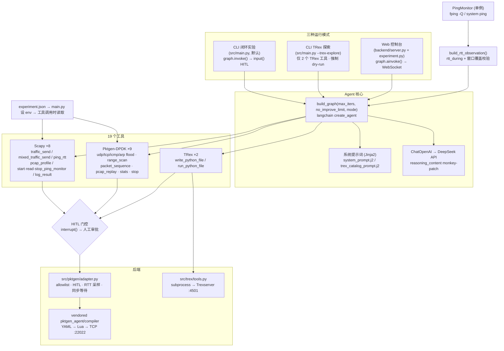

# Closed-Loop Network Experiment Agent

一个基于 **LangChain / LangGraph ReAct** 的闭环网络实验智能体：在严格的安全约束下，自动探索一组流量参数，并基于 **ping RTT 观测** 持续调参，使目标链路的 RTT 尽可能增大。

同时集成了两套硬件流量发生器能力：

- **Pktgen-DPDK**（无状态线速）——通过 vendored Lua 编译器生成 Lua 脚本下发到硬件发包；
- **Cisco TRex**（有状态 L4-L7）——由 Agent 生成 Python 客户端脚本并运行。

> 技术栈：Python 3.11+ · Scapy · LangChain/LangGraph · FastAPI · DeepSeek API · uv

---

## ⚠️ 合规与安全声明

本项目**仅限在本机或已完全授权的测试环境**中使用。它设计为网络实验 / 压测 / 教学演示用途，**严禁**用于攻击任何未授权目标。

内置多层安全约束（详见 [安全机制](#安全机制)）：

1. **allowlist 白名单**——所有流量工具在发包前校验目标 IP，不在白名单内直接拒绝；
2. **参数上限强制**——pps / 时长 / 包长 / 流数等均有硬上限；
3. **HITL 人工审批**——所有「产生流量」的工具都会在 `interrupt()` 处暂停，等待操作员显式批准；
4. **禁止**广播 / 组播、禁止伪造 `src_ip`、禁止无限循环发送。

使用本项目即表示你已获得目标环境的合法授权，并对自己的使用行为负责。

---

## 功能特性

- **19 个工具**：8 个 Scapy 工具 + 9 个 Pktgen-DPDK 工具 + 2 个 TRex 工具；
- **三种运行模式**：CLI 闭环实验（默认）/ CLI TRex 攻击目录探索 / Web 控制台；
- **闭环收敛**：ReAct 自主探索，连续 `no_improve_limit` 轮无 RTT 提升即早停；
- **后台 ping 监控**：优先 `fping -Q`（10 探针/秒高分辨率），无 `fping` 时回退系统 `ping`（跨平台）；
- **RTT 观测对齐**：每个流量工具结果附 `attack_window` / `observation_window` / `rtt_during`，LLM 校验观测是否真正覆盖攻击窗口；
- **严格安全门控**：allowlist + 参数上限 + HITL + 伪造/广播防护。

---

## 架构总览

三种运行时模式共用同一个 `build_graph()` → `CompiledStateGraph`（`MemorySaver` checkpointer），仅在选择提示词模板与工具集时不同。



**核心闭环**：LLM 推理 → 调用流量工具（HITL 审批）→ 采集 RTT 观测 → 依据 `reward = avg_rtt_ms − penalty(loss)` 调参 → 重复，直到 `max_iters` 或连续 `no_improve_limit` 轮无提升。

---

## 目录结构

```
Attack-Test/
├── src/
│   ├── main.py                      # CLI 入口：解析参数、设 env、HITL 轮询循环
│   ├── agent/
│   │   ├── graph.py                 # create_agent 建图、模型配置、提示词渲染、reasoning_content 补丁
│   │   ├── tools.py                 # 19 个 @tool 工具注册 + HITL 门控
│   │   └── state.py                 # Agent 状态定义
│   ├── tools/                       # Scapy 底层工具实现
│   │   ├── ping_rtt_tool.py         # 单次 ping RTT + allowlist 校验
│   │   ├── traffic_send_tool.py     # UDP 流量生成 + 参数钳制
│   │   ├── mixed_traffic_tool.py    # 多协议 JSON spec 流量
│   │   ├── pcap_profile_tool.py     # PCAP/PCAPng 流量画像
│   │   ├── ping_monitor.py          # 后台 ping 监控（fping -Q / system ping）
│   │   ├── rtt_window.py            # RTT 观测窗口构建
│   │   └── log_tool.py              # JSONL 实验日志
│   ├── pktgen/adapter.py            # Pktgen 适配器：allowlist/HITL/RTT/eth_dst 自动填充
│   ├── trex/
│   │   ├── tools.py                 # TRex 写脚本 + 运行（subprocess）
│   │   └── config.py                # TRex 配置读取（每次调用重读 env）
│   ├── prompts/                     # Jinja2 提示词模板
│   └── config/
│       ├── experiment.json          # 默认参数单一事实来源
│       └── allowlist.json           # 允许的目标 IP 白名单
├── backend/
│   ├── server.py                    # FastAPI：WebSocket + REST + 静态资源
│   └── experiment.py                # ExperimentManager：LangGraph ↔ WebSocket 异步桥
├── frontend/                        # Web 控制台（index.html / app.js / style.css）
├── pktgen_agent/                    # vendored Pktgen 引擎（编译器 + 客户端 + TCP 执行）
├── dsl/skills/*.yaml                # 9 个 Pktgen 技能定义
├── topology.yaml                    # Pktgen/TRex 主机端口、端口映射、dst_mac
├── tests/                           # unit / integration / e2e 测试
└── docs/                            # 设计文档与调试笔记
```

---

## 快速开始

### 环境要求

- Python 3.11+
- [uv](https://github.com/astral-sh/uv)（依赖管理）

### 安装依赖

```bash
uv sync                 # 安装运行依赖
uv sync --extra dev     # 附加测试依赖（pytest / pytest-cov）
```

### 配置

1. **LLM API Key**：复制 `.env_example` 为 `.env`，填入 DeepSeek API Key：

   ```bash
   cp .env_example .env
   # 编辑 .env：
   #   DEEPSEEK_API_KEY=sk-xxx
   #   LLM_MODEL=deepseek-chat
   ```

   > 也支持 `OPENAI_API_KEY` 作为 `DEEPSEEK_API_KEY` 的备选。

2. **allowlist 白名单**：编辑 `src/config/allowlist.json`，把允许的测试目标 IP 加进 `hosts` 数组。

3. **（可选）Pktgen/TRex 硬件**：编辑 `topology.yaml` 中的 `pktgen.host/port`、`trex.host/port`、`dst_mac`。

### 最小可运行示例

```bash
# Dry-run：仅编译 Lua，不发任何流量（默认模式）
uv run python src/main.py --target-ip 10.99.80.160 --max-iters 5
```

---

## 使用指南

### 三种运行模式

| 模式 | 命令 | 说明 |
|------|------|------|
| **CLI 闭环实验**（默认） | `uv run python src/main.py --target-ip <IP> --max-iters 5` | ReAct 探索流量参数使 RTT 最大化，HITL 用阻塞式 `input()` |
| **CLI TRex 探索** | `uv run python src/main.py --trex-explore` | 仅生成 ≥10 个带中文注释的攻击脚本（强制 dry-run，零流量零 HITL），摘要存 `output/trex_attack_catalog_<时间戳>.md` |
| **Web 控制台** | `uv run uvicorn backend.server:app --host 0.0.0.0 --port 8000 --reload` | 异步 WebSocket 循环，HITL 通过前端按钮审批，打开 http://localhost:8000 |

### CLI 常用命令

```bash
# 自动审批 HITL（跳过交互，谨慎使用）
uv run python src/main.py --target-ip 10.99.80.160 --max-iters 5 --auto-approve

# Pktgen 实发模式（真正下发流量到 Pktgen 硬件）
uv run python src/main.py --target-ip 10.99.80.160 --pktgen-live --max-iters 5

# 自定义攻击参数（默认来自 experiment.json：duration=10s, pps=100）
uv run python src/main.py --target-ip 10.99.80.160 --duration 10 --pps 500 --pktgen-rate 80

# 带 PCAP 流量画像
uv run python src/main.py --target-ip 10.99.80.160 --pcap-path data/sample.pcapng

# TRex 攻击目录探索（可指定数量与探索方向）
uv run python src/main.py --trex-explore --catalog-target 15 --max-iters 60
uv run python src/main.py --trex-explore --explore-direction "重点探索DNS放大攻击和TCP SYN洪水"

# TRex 实发模式（真正执行生成的 Python 脚本）
uv run python src/main.py --target-ip 10.99.80.160 --trex-live --max-iters 5
```

### 主要 CLI 参数

| 参数 | 默认 | 说明 |
|------|------|------|
| `--target-ip` | `10.99.80.160` | 流量与 ping 目标（必须在 allowlist） |
| `--max-iters` | 20（探索模式 40） | 最大迭代轮数 |
| `--no-improve-limit` | 5 | 连续 N 轮无改善即早停 |
| `--auto-approve` | `False` | 自动批准所有 HITL 请求 |
| `--duration` | 10 | Scapy 攻击时长（秒） |
| `--pps` | 100 | Scapy 每秒包数 |
| `--packet-size` | 64 | 包负载字节数 |
| `--flow-count` | 1 | 并发流数 |
| `--pktgen-live` | `False` | Pktgen 实发（默认 dry-run 仅编译 Lua） |
| `--pktgen-rate` | 50 | Pktgen 速率百分比（0–100） |
| `--trex-live` | `False` | TRex 实发（默认 dry-run 仅写脚本+语法检查） |
| `--trex-explore` | `False` | TRex 攻击目录探索模式 |
| `--catalog-target` | 10 | 探索模式最少生成脚本数 |
| `--explore-direction` | 空 | 探索方向（自由文本注入提示词） |

> `--trex-explore` 与 `--trex-live` 互斥（探索模式绝不发送流量）。

---

## 安全机制

### 三层门控

| 机制 | 说明 |
|------|------|
| **allowlist** | `validate_target()` 校验目标 IP ∈ `allowlist.json`，否则拒绝 |
| **参数上限** | 所有参数在工具内部硬钳制（见下表） |
| **HITL** | 所有流量工具在 `interrupt()` 暂停，等待操作员批准 |

### 参数上限

| 参数 | 上限 | 常量 |
|------|------|------|
| pps | 20000 | `MAX_PPS` |
| duration_s | 20 | `MAX_DURATION_S` |
| packet_size | 1024 | `MAX_PACKET_SIZE` |
| flow_count | 100 | `MAX_FLOW_COUNT` |
| iat_jitter_ms | 20 | `MAX_IAT_JITTER_MS` |
| mixed 流数 | 100 | `MAX_STREAMS` |
| Pktgen rate | 100% | skill YAML 约束 |
| Pktgen duration | 60000 ms | `_wait_for_attack` 封顶 |

### HITL / allowlist 门控矩阵

| 技能 | allowlist（`dst_ip`） | HITL |
|------|:---:|:---:|
| `udp_flood` / `tcp_flood` / `icmp_flood` | ✅ | ✅ |
| `arp_flood` | ❌（L2 无 IP） | ✅ |
| `range_based_scan` / `packet_sequence_generation` | ✅ | ✅ |
| `pcap_replay` | ❌（使用 PCAP 自带 dst） | ✅ |
| `stats_monitoring` / `safe_stop_and_reset` | N/A | ❌ |

### 其他安全约束

- 所有流量工具禁止**广播 / 组播**、禁止**伪造 `src_ip`**；
- `pktgen_packet_sequence` 会自动把 LLM 臆造的 MAC 地址替换为 `topology.yaml` 中真实的 `dst_mac`，防止 LLM 编造未知 MAC；
- `mixed_traffic_send` 强制用 `dst_ip` 参数覆盖 JSON spec 中的 `IP.dst`；
- `--trex-explore` 在结构上只注册 2 个 TRex 写/检查工具，根本不存在可调用的流量工具，因此零流量零 HITL。

---

## 配置说明

### 配置流

```
experiment.json  →  main.py 设置环境变量  →  工具调用时读取
     │                     │                       │
     │ "attack": {         │ ATK_DURATION_S=10      │ duration_s = env or 10
     │   "duration_s": 10  │ ATK_PPS=100            │ pps = env or 100
     │   "pps": 100        │                        │
     │   ...               │ PKTGEN_RATE=50         │ rate = env or 50
     │ }                   │                        │
     │ "pktgen": {         │                        │
     │   "rate": 50        │                        │
     │   "duration_ms":…   │                        │
     │ }                   │                        │
     └─────────────────────┘                        ┘
```

### 关键配置文件

| 文件 | 作用 |
|------|------|
| `src/config/experiment.json` | 默认参数单一事实来源（目标 IP、max_iters、攻击参数、pktgen/trex 参数） |
| `src/config/allowlist.json` | 允许的目标 IP 白名单 |
| `topology.yaml` | Pktgen/TRex 主机端口、TX/RX 端口映射、`dst_mac` |
| `.env` | LLM API Key（`DEEPSEEK_API_KEY` / `OPENAI_API_KEY`）、`LLM_MODEL` |

---

## 测试

```bash
uv run pytest tests/unit/ -v            # 单元测试（无 I/O）
uv run pytest tests/integration/ -v     # 集成测试（真实编译器、mock 网络）
uv run pytest tests/ -v                 # 全部测试
uv run pytest --cov=src --cov-report=term-missing   # 带覆盖率
```

- `tests/unit/`：mock 所有 I/O；`conftest.py` 把项目根加入 `sys.path`；
- `tests/integration/`：真实编译器、真实配置、mock 网络；`conftest.py` 有 session 级 Pktgen 可用性检测（不可达自动跳过）；
- `tests/e2e/`：完整 Agent 闭环测试；
- `pyproject.toml` 注册了 `unit` / `integration` / `slow` 三个 pytest marker。

---

## 相关文档

| 文档 | 内容 |
|------|------|
| `docs/trex-integration.md` | TRex 接入工作项概览（ASTF 有状态流量） |
| `docs/knowledge-base.md` | 智能测试知识库需求分析 |
| `docs/front-end.md` | 前端 / Web 控制台设计 |
| `docs/debugging/cross_platform.md` | 跨平台调试笔记 |
| `docs/debugging/scapy_decimal.md` | Scapy 数值处理调试笔记 |
| `docs/architecture.html` | 架构图（HTML，含 PNG 导出） |

---

## License

本项目尚未指定 License。对外使用 / 分发前请先补充。
